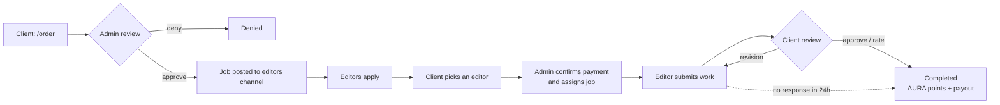

# EditorsHub-AURA — Telegram Marketplace Bot for Video Editing

A Telegram bot that runs a small freelance marketplace end to end: clients place video-editing orders, editors apply for jobs, an admin approves work and payments, and an **AURA reputation system** ranks editors by their track record. Google Sheets serves as the database, so the business owner can see and edit every record without a custom admin panel.

**~3,400 lines of async Python** · python-telegram-bot 21 · Google Sheets API · OpenAI Moderation · APScheduler · Docker

## How an order moves through the system



## Features

**Clients**
- Guided order form (category, duration, number of videos, deadline, budget, raw files, reference) with cancel at any step
- `/myorders` to track status and message the assigned editor
- Approve the final cut, request a revision, or rate the editor

**Editors**
- Registration with a skill test submission that the admin evaluates
- Apply to jobs from the channel, submit work, raise complaints
- `/leaderboard` and `/appliedjobs`
- AURA tiers: Rookie → Skilled → Pro → Elite → Legend (points for completed and 5-star jobs, penalties for revisions and late delivery)

**Admins**
- `/dashboard` with revenue, platform margin, editor payouts and order pipeline counts
- Approve or deny orders, post jobs, grant assignments, confirm payments
- Role management: the super admin can `/promote` and `/demote` other admins

**Platform safety**
- **Anonymous relay chat**: clients and editors talk through the bot and never see each other's contact details
- **Two-layer moderation**: a regex pre-filter blocks phone numbers, emails and social handles, then the OpenAI Moderation API checks for harassment, hate and other abuse. Flagged messages are not delivered and are logged to a `Moderation` sheet. If the API is down, messages are allowed through so the bot keeps working.
- **Automation**: a scheduler auto-approves submissions after 24 hours without a client response, and a 15% platform margin is calculated on every order

## Architecture

```text
editorshub_aura/
  bot.py               Entry point: registers commands, conversations and callbacks
  config.py            Reads all settings from environment variables
  setup_sheets.py      Creates the Google Sheets tabs and headers on first start
  handlers/            One module per role: client, editor, admin, admin_post, auth, relay
  services/
    aura.py            Reputation tiers and point rules
    moderator.py       OpenAI moderation wrapper (fails open)
    revenue.py         Platform margin calculation
    scheduler.py       Auto-approve job (APScheduler)
  database/sheets.py   Google Sheets data access (gspread)
  health/server.py     Flask health endpoint for the hosting platform
  utils/               Admin checks, inline keyboards, order ID generator
```

Data lives in eight sheets: `Orders`, `Clients`, `Editors`, `Applications`, `Submissions`, `Profit`, `Admins` and `Moderation`.

## Run it locally

Prerequisites: Python 3.12, a bot token from [@BotFather](https://t.me/BotFather), and a Google Cloud service account with access to a Google Sheet.

```bash
git clone https://github.com/dhanushkumat04062007-ship-it/editorshub-telebot.git
cd editorshub-telebot
pip install -r requirements.txt
cp .env.example editorshub_aura/.env   # fill in your values
cd editorshub_aura
python bot.py
```

The bot creates any missing sheet tabs on startup.

## Deploy

- **Docker:** `docker build -t editorshub-bot . && docker run --env-file editorshub_aura/.env editorshub-bot`
- **Render:** `render.yaml` defines a free background worker. Connect the repo and fill in the environment variables in the Render dashboard.

## Commands

| Who | Commands |
|---|---|
| Everyone | `/start` |
| Clients | `/order`, `/myorders` |
| Editors | `/register`, `/submit`, `/appliedjobs`, `/leaderboard`, `/complaint` |
| Admins | `/dashboard`, `/manage`, `/promote`, `/demote` |

## Roadmap

- Move from Google Sheets to PostgreSQL once order volume grows
- Unit tests for the AURA, revenue and moderation services
- Payment gateway integration instead of manual payment confirmation

## License

MIT
